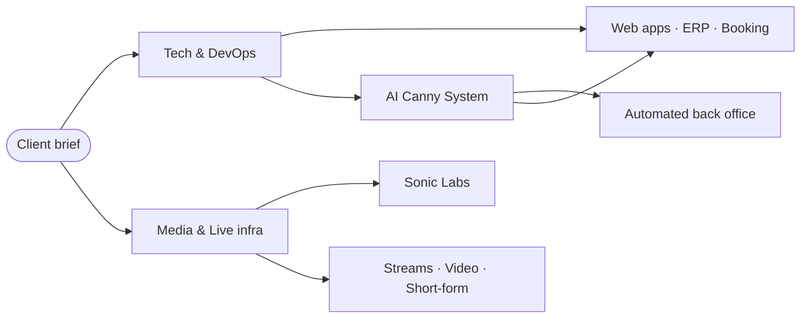

<div align="center">


<a href="https://jmmentertainment.com">
  
</a>

<br/>

<a href="https://jmmentertainment.com"></a>


</div>

<br/>

```ts
const jmm = {
  company:   "JMM Entertainment Ltd.",
  formerly:  "JMM Studio",
  hq:        "Bangkok, Thailand",
  builds:    ["custom software", "AI automation", "media infrastructure"],
  for:       "the entertainment industry and the businesses around it",
  motto:     "Straightforward solutions. Professional execution.",
};
```

---

## ⚙️ What we engineer

<table>
<tr>
<td width="50%" valign="top">

### 🧩 Tech &amp; DevOps
Full‑stack product development, from database to deployment.
Booking engines, ERP/POS systems, creator platforms and web apps for real businesses.

</td>
<td width="50%" valign="top">

### 🤖 AI Canny System
Our in‑house AI layer. It orchestrates several AI tools to automate back‑office operations, and it ships the AI features in our client sites.

</td>
</tr>
<tr>
<td width="50%" valign="top">

### 📡 Live &amp; Media Infrastructure
Multi‑camera, multi‑platform live streaming, including live commerce. Production pipelines for video, photo and short‑form content at scale.

</td>
<td width="50%" valign="top">

### 🎛️ Sonic Labs
Audio engineering and music production. Jingles, brand sound and short‑form tracks built for TikTok, Reels and Shorts.

</td>
</tr>
</table>

---

## 🚀 Shipped

| Project | What it is | Type |
|:--|:--|:--:|
| **Lomprayah** | Ferry ticket booking engine | `booking` `payments` |
| **Sitt Textile** | ERP + point‑of‑sale system | `erp` `pos` |
| **iConnect** | Creator platform | `platform` `creators` |
| **Website Subscription** | Managed sites with booking and AI, from ฿4,500/mo | `saas` `ai` |

---

## 🏗️ How the pieces fit



---

## 🧰 Stack

<div align="center">

**Frontend**<br/>


**Backend &amp; Data**<br/>


**Infra &amp; Delivery**<br/>


</div>

---

## 📈 Footprint

<div align="center">

| 🤝 Brand clients | 🎞️ Media assets | 📡 Est. reach | 🎵 Archive views | 📍 Locations |
|:---:|:---:|:---:|:---:|:---:|
| **50+** | **1,000+** | **50M+** | **~100M** | **BKK · Songkhla · Satun · Pattaya** |

<sub>Trusted by teams at Lomprayah · Bitkub · PTT Group · Bright TV · Chulalongkorn University · Miss Grand Thailand · Big One Group · Hansar Samui · and more</sub>

</div>

---

## 🧭 How we work

- **Ship, then sharpen.** Working software in front of the client early, then iterate.
- **Automate the boring parts.** If a task repeats, the AI Canny System should be doing it.
- **Own it end to end.** Design, build, deploy and run, under one roof.

> *Reputation precedes the pitch.*

---

<div align="center">

### 📬 Build with us

<a href="https://jmmentertainment.com"></a>
<a href="mailto:center@jmmentertainment.com"></a>
<a href="https://lin.ee/w12sRT8"></a>
<a href="https://www.tiktok.com/@jmm_entertainment"></a>
<a href="https://www.instagram.com/jmm_.entertainment"></a>
<a href="https://www.facebook.com/profile.php?id=61582297034083"></a>

<br/><br/>

<sub><code>© JMM Entertainment Ltd. · Bangkok, Thailand</code></sub>

</div>
